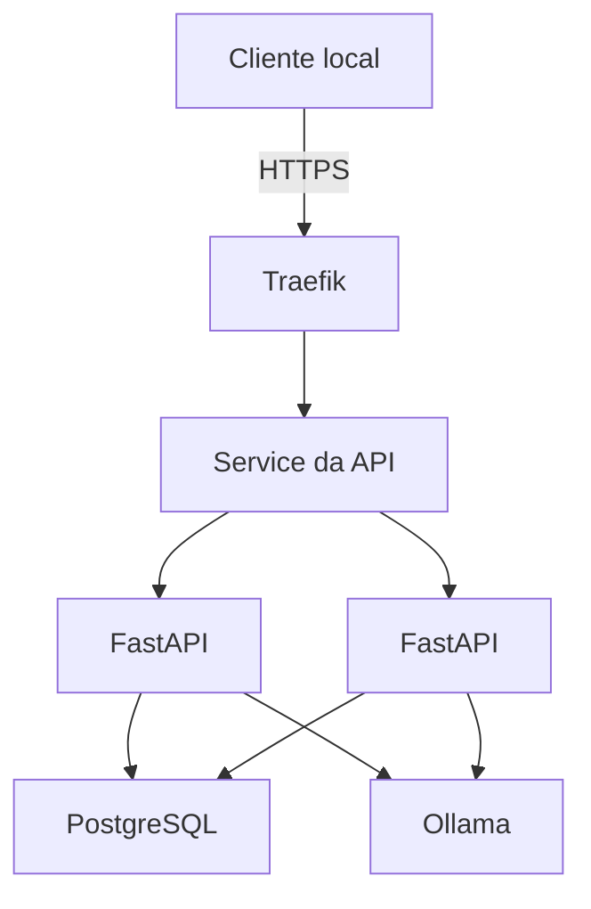

# Cloud Native Zero Lab

API FastAPI compatível com a-Shell no iPhone e PostgreSQL Neon.

## Rotas
- `GET /` — identificação
- `GET /health` — liveness local
- `GET /dbstatus` — consulta real ao Neon
- `GET /messages` — lê registros da tabela `teste_iphone`
- `POST /messages` — grava mensagem na tabela `teste_iphone`

## Instalação no a-Shell

Instalar dependências:

`python3 -m pip install -r requirements-iphone.txt`

Definir a variável de ambiente `NEON_DB_PASSWORD` **sem colocar a senha no código ou em comandos enviados ao chat**. O método de entrada segura depende do suporte do a-Shell.

Iniciar:

`python3 -m uvicorn main:app --host 127.0.0.1 --port 8000`

Acesse pelo navegador no mesmo iPhone, enquanto o processo estiver ativo.

## Hospedagem e testes

O arquivo render.yaml prepara um serviço web no plano Free em Oregon. Após vincular o repositório ao Render e configurar NEON_DB_PASSWORD como segredo, o Render acompanha a branch main e publica depois que os testes passam. O serviço usa o endpoint pooled do projeto Neon existente. Se o provedor exigir cartão, interrompa a ativação.

O GitHub Actions executa os testes a cada push ou pull request, usando um PostgreSQL 17 temporário e independente do Neon. O teste de integração cria a tabela no banco de teste, grava uma mensagem pela API e confirma sua leitura em outra requisição.

Para executar os testes locais, instale requirements-test.txt e rode python -m unittest discover -s tests -v. Para incluir a integração, use um PostgreSQL descartável em 127.0.0.1, banco lab_ci, e as variáveis do workflow.

As rotas de mensagens do protótipo são abertas. Use apenas dados de demonstração caso publique o serviço.

## Laboratório Kubernetes local

O cluster k3d roda em Docker no computador ou no executor temporário do GitHub Actions. A entrada HTTPS escuta em 127.0.0.1:8443. A arquitetura fica assim:

Kubernetes mantém duas réplicas da API e pode escalar até quatro conforme a utilização de CPU. PostgreSQL e Ollama têm serviços internos e políticas de rede que só aceitam conexões dos pods da API. A aplicação recebe um usuário de banco com permissão de leitura e inserção. O tráfego interno do PostgreSQL local usa TCP. A conexão externa com o Neon continua usando TLS.

Com Docker, k3d, kubectl, openssl e jq disponíveis, execute `bash k8s/up.sh` e `bash k8s/check.sh`. O primeiro comando também baixa o modelo Qwen2.5 0.5B para inferência local em CPU. A documentação interativa fica em https://localhost:8443/docs, com certificado autoassinado. A rota POST /ia recebe o campo pergunta e devolve resposta. O segundo comando testa HTTPS, gravação, leitura, inferência e restrição de acesso aos serviços internos.

O banco do cluster começa vazio e usa volume persistente durante a vida do cluster. O workflow sobe seu próprio cluster descartável. O perfil Render/Neon e a execução no iPhone continuam separados desta instalação.

## Acesso pelo celular

A interface em `/chat` envia cada pergunta para a API do mesmo serviço. O navegador exibe a resposta e mantém o histórico somente na aba. No cluster, ela utiliza Qwen2.5 0.5B. A configuração Docker para Render Free inclui um modelo menor, SmolLM2 135M, para caber na memória da instância. O banco do serviço Render continua sendo o Neon. O CI verifica a inferência com limite de memória e verifica o aumento de réplicas do Kubernetes sob carga de CPU.

[Configurar a hospedagem Free no Render](https://render.com/deploy?repo=https://github.com/rafael-backend-lab/cloud-native-zero-lab)

O Render gera LAB_ACCESS_PASSWORD. Entre com o usuário rafael e essa senha para usar a interface ou a API. A rota /health permanece acessível para a verificação do serviço.
